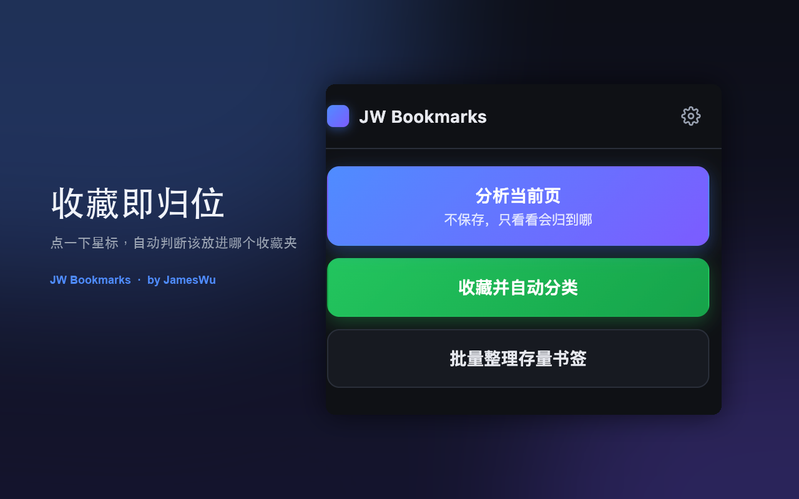

# JW Bookmarks

> 收藏即归位 · by JamesWu · v1.4.0

收藏网页时自动判断该放进哪个收藏夹的 Chrome 扩展（Manifest V3）。



**核心特性**

| 特性 | 说明 |
| --- | --- |
| 🎯 收藏即归位 | 点一下星标，自动判断该放进哪个收藏夹 |
| 🤖 AI 双引擎 | DeepSeek 理解内容 → Jev 判断归类（概率经过校准）|
| 🗳️ 拿不准就问你 | 弹窗给 3 个候选 + 概率值，不硬猜 |
| 📦 批量整理 | 存量书签一键重排，跑在后台、关掉弹窗也不中断 |
| 🗄️ 一键归档 | 旧文件夹整体收进归档夹，重新开始 |
| 🔒 隐私优先 | 数据只在本机；仅规则未命中时发送「标题 + 网址」到**你自己配置的** API |

更多界面：[批量整理](docs/screenshots/02-批量整理.png) ·
[设置页](docs/screenshots/03-设置.png) ·
[3 候选选择窗](docs/screenshots/04-选择窗.png)

## 它是怎么工作的

分类结果分三种处理方式：

```
本地规则命中（不联网）──────────────▶ 直接保存
        │ 未命中
        ▼
① DeepSeek「分析」：读懂网页 + 现有文件夹结构，
   高召回初筛候选（最多 6 个），必要时建议新文件夹名
        │
        ▼
② Jev「判断」：带着上面的分析，在候选里定夺，
   给出校准过的概率与置信度
        │
        ├─ 最高概率 ≥ 阈值 ──▶ 直接保存
        └─ 低于阈值 ────────▶ 弹出选择窗口（top-3 + 概率 + 新建）
```

**分工**：DeepSeek 管「理解与生成」（LLM 的强项，还能生成新文件夹名），
Jev 管「判断与置信度」（决策模型的强项——它的概率是**校准过的**，比 LLM 自报的可靠）。

两者**分开配置**，各用自己的 API Key / 地址 / 模型。任一方缺失也能工作：

- 只配 DeepSeek → 直接用它的初筛候选
- 只配 Jev → Jev 跳过高召回初筛，直接在全部文件夹里判断

## 目录结构

```
jw-bookmarks/
├── manifest.json
├── background.js        # Service Worker：onCreated 自动搬运、右键菜单、picker 流程、消息路由
├── lib/
│   ├── providers.js     # Jev + DeepSeek 客户端（独立配置）
│   ├── classifier.js    # 分类核心：规则 → Jev → DeepSeek，输出 top-3 候选
│   ├── organizer.js     # 批量整理（跑在后台，关弹窗也不中断）
│   └── i18n.js          # 显示层本地化（Bookmarks Bar → 书签栏）
├── icons/               # 扩展图标 16 / 32 / 48 / 128
├── picker.html/.css/.js # 选择弹窗：3 个候选 + 概率条 + 新建/取消
├── popup.html/.css/.js  # 扩展弹窗：操作 / 批量整理 / 设置 三个视图
└── README.md
```

## 安装

### 本地加载（自用 / 开发）

1. 打开 `chrome://extensions`
2. 右上角打开「开发者模式」
3. 点「加载已解压的扩展程序」，选择**本仓库根目录**
4. 点扩展图标 → 右上角齿轮 ⚙ → 填好 Jev / DeepSeek 的 API Key 并保存

> ⚠️ **需要自备模型 API Key**
>
> 本扩展**不提供**模型服务，你需要自己准备 [TypeSafe Jev](https://typesafe.ai)
> 与 [DeepSeek](https://platform.deepseek.com) 的 Key。两者可只配其一；
> 一个都不配时，仅「本地规则」可用。

## 触发方式

- **原生星标**：点地址栏星标收藏后，插件等约 3 秒（可调）自动分类。
  很确定 → 直接搬进目标文件夹；拿不准 → 弹出「归到哪个文件夹」选择窗口（3 个候选 + 概率）。
  若你在原生弹窗里手动改了标题/文件夹，插件会尊重你的手动操作、放弃自动分类。
- **右键菜单**：网页上右键 → 「收藏到自动分类」。
- **弹窗**：点扩展图标 → 「分析当前页（不保存）」试一下会怎么分，或「收藏并自动分类」。

## 批量整理存量书签

点扩展图标 → 「批量整理存量书签」，在弹窗内切换到整理视图：

1. 选范围：**仅未整理**（顶层散落的书签）或 **全部书签**。
2. 可选勾选「高置信度直接归位」（默认开）。
3. 点「开始整理」：进度条 + 「正在处理 n/N：标题」实时刷新。
4. 结束后给出统计（自动归位 / 待确认 / 跳过），「待确认」的书签逐个列出，
   每个带最多 3 个候选 + 概率，点一个即归位；也支持「新建」或「跳过」。

> **整理在后台 service worker 里跑，关掉弹窗也会继续**，重开弹窗即可接着看进度。

> 注意：批量整理会**逐个调用分类模型**，书签多时耗时较长且产生 API 费用。
> 先小范围（仅未整理）试跑一次再决定是否全量。

## 一键归档（重新开始收藏）

在「整理」视图底部有「一键归档」：

1. **归档名**：填归档文件夹的名字（默认 `旧收藏 2026`，随便改）。
2. **勾选要归档的文件夹**：列表带书签数量，可滚动；顶层散落的书签会单独列一项。
3. 点「归档选中项」→ 按钮变红提示，**再点一次**才真正执行。

归档后：

- 选中的文件夹整体挪进归档文件夹，书签栏顶层立刻干净。
- **归档文件夹的 id 会被记进 `archivedFolderIds`**，之后新收藏的分类候选里**永远不会再出现它们**
  —— 这才算真正「重新开始」。
- 重复归档是幂等的（再归档会塞进同名归档文件夹）。
- 想让它们重新参与分类：清掉 `chrome.storage.local` 里的 `archivedFolderIds` 即可。

## 选择弹窗说明

- 展示最多 3 个候选文件夹，按概率降序排列，每个带概率条和百分比。
- 概率最高的标「推荐」。
- 底部「新建文件夹」输入框：填名字即可新建并归入；走 DeepSeek 兜底时会给建议名并自动预填。
- 「保持当前位置」= 不自动分类，书签留在原处。
- 文件夹名按中文显示：Chrome 内置的 Bookmarks Bar / Other Bookmarks 会显示成 书签栏 / 其他书签。

## 自动保存阈值

设置里的「阈值」（默认 0.8）：

- 最高候选概率 ≥ 阈值 → **直接保存**，不打扰你。
- 低于阈值 → **弹出选择窗口**让你确认。

想更省事就调低（更爱自动存），想更可控就调高（更爱弹窗确认）。

## 本地规则语法

设置里的「本地规则」文本框，每行一条，`#` 开头为注释：

```
domain:github.com => 工作/开发
domain:zhihu.com => 阅读/收藏
keyword:react => 工作/前端
```

- `domain:` 匹配网址的域名
- `keyword:` 匹配「标题 + 网址」
- `=>` 右侧是目标文件夹路径（用 `/` 表示层级，需与真实收藏夹层级一致）

### 内置默认规则

首次使用预置了一批常用域名的规则（微信公众号 / 飞书 / 语雀 / Notion / GitHub /
掘金 / CSDN / Stack Overflow / MDN / 知乎 / B站 / 小红书 / Figma 等）。

- **规则为空时自动使用默认规则**；你在设置里改动并保存后，以你保存的为准。
- 规则指向的文件夹**不存在会自动创建**（建在「书签栏」下），所以「微信公众号 → 微信公众号」
  这类规则开箱即用，不用先手动建文件夹。
- 域名匹配是「精确域名 + 子域名」：`github.com` 能匹配 `www.github.com`，
  但不会误伤 `notgithub.com`。

## 排除的文件夹（不参与自动分类）

设置里的「排除的文件夹」文本框，每行一个，两种写法都支持：

```
待整理
工作/归档
```

- **匹配规则**：文件夹名，或「父/子」完整路径，任一命中即生效（连同其子文件夹）。
- **效果有两层**：
  1. **不会成为分类候选** —— 模型不会把这些文件夹当目标；
  2. **批量整理会跳过它们内部的书签** —— 里面的东西不会被重新搬出来。
- 本地规则若指向被排除的文件夹，该条规则会被跳过（交给后面的模型判断），
  避免又被自动建出来。

> 归档文件夹（以「旧收藏」开头）是**自动排除**的，不用在这儿再写一遍。

## 配置备份 & 固定扩展 ID

### 导出 / 导入配置

设置页底部的「配置备份」：

- **导出**：把 Jev / DeepSeek 的 Key、本地规则、阈值、排除列表、归档记录打包成 JSON 下载。
- **导入**：选那个 JSON 即可恢复。
- ⚠️ 导出文件里含**明文 API Key**，请自己保管好。

### 固定扩展 ID（升级 / 改名都不丢配置）

`manifest.json` 里有 `key` 字段，扩展 ID 因此是**由公钥算出来的**，跟文件夹路径无关：

```
扩展 ID：mlpjmanademmdgjbbffmpahnbnapghof
```

**好处**：以后改文件夹名、移动位置、重新加载，`chrome.storage.local` 里的配置都不会丢。

> 背景：未打包扩展默认按**路径哈希**算 ID —— 路径一变 ID 就变，Chrome 会当成新扩展，旧配置就找不回来了。

- 私钥 `jw-bookmarks-signing-key.pem` 放在扩展文件夹**外面**，只有打包 CRX / 上架时才用得到。
- ⚠️ **若要上架 Chrome Web Store，需先把 `key` 字段删掉**，否则可能被拒（商店会自己生成 ID）。

## 权限说明

- `bookmarks`：读写收藏夹（核心功能）
- `storage`：保存配置与规则（含 `storage.session`，用于 picker 临时数据）
- `contextMenus`：右键菜单
- `activeTab`：弹窗读取当前标签页
- `host_permissions`：仅 `api.typesafe.ai` 与 `api.deepseek.com`

## ✅ Jev 接口契约（已按官方 api.md 核对）

1. **Jev 接口契约**：TypeSafe 原生接口是 `POST /v1/systemone`（decider 决策格式）。
   请求体 `{ state, model, questions }`，`questions` 为 `map<string, Question>`，
   choice 题的 `criteria` 是 `{ 选项名: 描述|null }`；响应取
   `answers[<id>].{ choice, probabilities, confidence }`。模型别名默认 `jev-latest`，
   其它可用 `jev-preview` / `jev-1.13.0`（设置里可改）。

2. **改 API 地址**：如果换成自建代理或其它域名，需要把对应 origin 加进 `manifest.json` 的
   `host_permissions`，否则会因权限被拦。

## 隐私说明

> **一句话：数据都留在你本机。只有你主动配置的 Jev / DeepSeek 会收到「网页标题 + 网址」，且仅在你没写规则命中时才发。**

### 读取了什么

- `bookmarks`：读取收藏夹结构（用于生成候选文件夹），并在需要时移动书签。
  这是核心功能，读取内容**不做任何上传**。
- `activeTab`：只在你点开弹窗、点按钮时读当前标签页的标题和网址。

### 存在哪里

| 数据 | 位置 | 会随账号同步吗 |
|---|---|---|
| Jev / DeepSeek 的 API Key | `chrome.storage.local`（本机） | ❌ 不会 |
| 阈值、等待时长等配置 | `chrome.storage.local` | ❌ |
| 本地规则 | `chrome.storage.local` | ❌ |
| 已归档文件夹 id | `chrome.storage.local` | ❌ |
| picker 临时数据 | `chrome.storage.session`（关浏览器即清） | ❌ |

### 联网行为

- **只有「本地规则未命中」时才联网**；命中规则的书签**完全不发请求**（零延迟、零成本）。
- 发送内容**仅为「网页标题 + 网址」**，不抓取正文、不发送你其它书签。
- 请求只发往**你自己配置的地址**（默认 `api.typesafe.ai` 与 `api.deepseek.com`）。
  换成自建代理时，需把新域名加进 `manifest.json` 的 `host_permissions`。

### 不做什么

- ❌ 无统计埋点、无遥测、无第三方服务器中转
- ❌ 不读浏览历史、不读 cookies、不注入/篡改页面内容
- ❌ 不上传你的书签列表

### 成本

- 只有联网分类才消耗 API 额度（Jev / DeepSeek 各自计费）。
- 本地规则命中的书签零成本。批量整理会逐个调用模型，书签多时费用相应增加。
